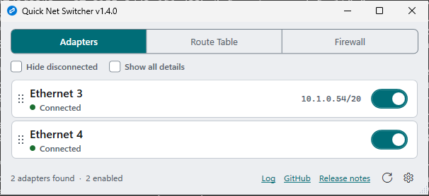
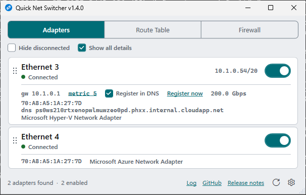
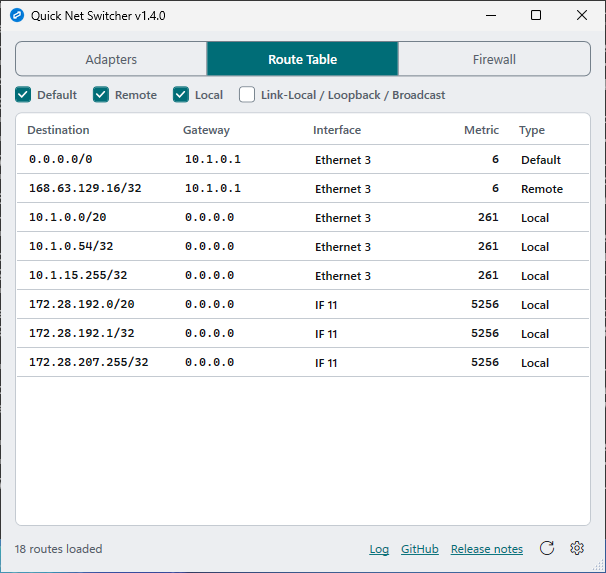
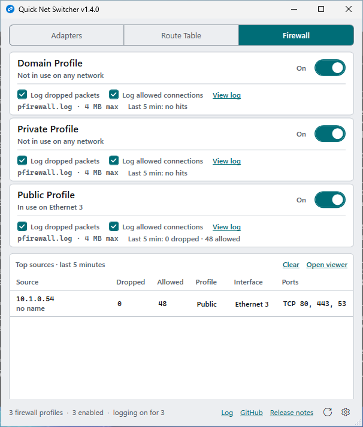
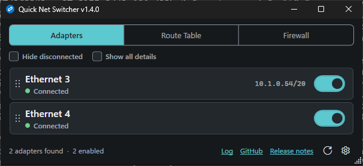

# Quick Net Switcher

A small Windows utility for switching network adapters and firewall profiles on and off, kept in the system tray.


[GitHub](https://github.com/darthrater78/windows_quick_net_switcher) · [v1.3.1 release notes](https://github.com/darthrater78/windows_quick_net_switcher/releases/tag/v1.3.1)

## Features

**Adapters tab**
- View all physical network adapters with status and IP/CIDR on one line each. Click an adapter for its gateway, interface metric, speed, MAC address, DNS suffix and device name, or tick "Show all details" to open every row
- The list keeps itself current: Windows announces network changes and the app reacts to them, so dropping off Wi-Fi or unplugging a cable shows up on its own, with a 10-second check behind that as a backstop
- Toggle adapters on/off with a single click
- Drag-to-reorder the adapter list by its handle, with a translucent ghost of the whole row following the pointer and a bar marking where it will land — order is remembered between launches
- Hide disconnected adapters, to cut the list down to the ones actually carrying a network
- Edit an adapter's interface metric (1–9999) by clicking the metric in its details
- Turn "Register this connection's addresses in DNS" on or off from an adapter's details; the box shows what Windows has set
- "Register now" re-registers the computer in DNS and checks the result: whether the name now points at the adapter's address, its reverse record, and any DNS Client warnings in the System event log

**Route Table tab**
- View the system route table with friendly adapter names
- Filter by route type

**Firewall tab**
- Toggle Windows Firewall on/off per profile (Domain, Private, Public)
- Turn logging of dropped packets and allowed connections on or off per profile. Logging turned on in the app is turned off again when the app closes (or at the next launch, if it didn't close cleanly); logging that was already on is left alone
- A hits panel under the profiles shows the busiest source addresses in the last 5 minutes, with how many of their packets were dropped and allowed, the profile and interface they came in under, and the ports they hit. Each profile row shows which network it is in use on and its own dropped/allowed counts. Clear starts the count again; every column sorts
- View the firewall log in the app, whether or not logging is on now, newest first, following new lines as Windows writes them. Sort by any column, filter by action, protocol, interface or profile from the column headers, or by address, port or name. "Clear log file…" empties the log and removes its `.old` copy, after a confirmation. "Copy all" copies every line shown; Ctrl+C copies the selected ones
- Names next to addresses: local-network addresses are looked up automatically; outside addresses only when "Resolve names" is ticked in the viewer. The address is always shown

**Activity log**
- A log above the footer, opened from its "Log" link, records DNS registration runs, logging changes and errors; highlight any part of it, or copy or clear it all. Drag the bar above it to resize; it keeps its share of the window as the window is resized

**General**
- One copy at a time: launching it again brings the running copy to the front
- System tray icon — minimize to tray and keep it running in the background
- Pin to desktop — keep the window on the desktop layer behind other apps, like a widget (on by default)
- The window fits what it shows: the adapter list grows and shrinks as rows' details open and close or "Show all details" is ticked, the Firewall tab fits the profiles and the hits panel, and opening the activity log makes room for it. The route table and the full firewall log keep the height you give them
- Dark theme — follows the Windows app theme by default, with a toggle in the settings menu to override it. Both themes cover the window chrome, tabs, buttons, checkboxes, scrollbars, the route grid, the metric dialog, the title bar and the tray menu
- Accent colour — teal by default; the settings menu also offers your Windows accent colour, green, or none. It colours switches that are on, the selected tab, ticked boxes, links and the tray icon
- Settings are persisted between sessions (minimize-to-tray, pin-to-desktop, hide-disconnected, show-all-details, the accent, and the theme once you pick one)
- Custom app icon, and a look recorded in [`DESIGN.md`](DESIGN.md)
- Links to the project on GitHub and to the running version's release notes, in the footer of every view
- Runs as administrator (required to enable/disable adapters and change firewall/metric settings)
- Single-file self-contained executable — no .NET runtime install needed

## Screenshots

Captured from a real build on a GitHub Windows runner by the repository's
Screenshots workflow, so the adapters, addresses and routes shown are that
runner's.







## Download

Download the latest release from the [Releases page](https://github.com/darthrater78/windows_quick_net_switcher/releases/latest).

## Requirements

- Windows 10 or Windows 11
- Administrator privileges (the app requests elevation on launch)

## Security Model

This app asks for administrator rights, so it should be able to explain exactly
what it does with them. This section describes the actual behaviour of the code,
including the parts that are worth knowing before you run it elevated.

### Why it needs administrator

These operations are gated behind admin rights by Windows itself:

| Operation | Mechanism | Why elevation is required |
|---|---|---|
| Enable/disable an adapter | WMI `Win32_NetworkAdapter.Enable()` / `.Disable()` | Changing device state is an administrative operation |
| Change an interface metric | `netsh interface ipv4 set interface` | Modifies the system routing configuration |
| Toggle a firewall profile | `netsh advfirewall set <profile>profile state` | Modifies Windows Firewall policy |
| Turn firewall logging on/off | `netsh advfirewall set <profile>profile logging droppedconnections\|allowedconnections` | Modifies Windows Firewall policy |
| Turn DNS registration on/off | WMI `Win32_NetworkAdapterConfiguration.SetDynamicDNSRegistration` | Changes the adapter's TCP/IP configuration |
| Register now | `ipconfig /registerdns` | Asks the DNS Client service to re-register every adapter |
| Read the firewall log | Opens `pfirewall.log` read-only | The log folder is readable only by administrators |
| Clear the firewall log | Truncates `pfirewall.log` and deletes `pfirewall.log.old`; if the firewall service refuses, pauses logging to it, truncates, and restores logging exactly as it was | The log folder is writable only by administrators |

Everything else the app does — listing adapters, reading the route table,
reading firewall state and logging settings, reading DNS Client events — is
read-only.

### Scope of elevation

The manifest (`Properties/app.manifest`) requests `requireAdministrator` with
`uiAccess="false"`, which elevates **the entire process**. There is no split
broker/UI design: the WPF interface, the WMI calls, and the `netsh` calls all
run inside one elevated process. The practical consequence is that the trust
decision is about the binary as a whole, not about one privileged component.

Two things are deliberately kept *out* of that elevated scope:

- **Opening links.** The footer's URLs are handed to `explorer.exe` rather than
  shell-executed. A direct `ShellExecute` from an elevated process would launch
  your default browser as administrator; delegating to the already-running
  user-level shell keeps the browser unelevated.
- **Stored settings.** Both JSON files live under `%LOCALAPPDATA%`, per-user, not
  in a machine-wide or world-writable location.

### Why there is no "start with Windows"

Versions 1.1.0 through 1.2.1 offered a start-with-Windows checkbox that wrote a
value under `HKCU\...\CurrentVersion\Run`. It never worked, and could not: the
shell launches Run entries **unelevated**, this app is manifested
`requireAdministrator`, and UAC has no interactive desktop to prompt on that
early in logon — so Windows discarded the entry every time, silently. The value
was created and the app never appeared.

The option was removed in v1.3.0 rather than reimplemented, because the
mechanism that *does* work — a scheduled task registered at
`RunLevel=HighestAvailable` with a logon trigger — is a silent elevation path.
Task Scheduler would start this process as administrator at every logon with no
prompt, so anyone able to overwrite the executable would get administrator on
the next logon. That is easy while the app lives in `Downloads` or any other
folder a standard user can write to, which is the normal case for a portable
single `.exe`, and there is no code signature to make the substitution visible.
Trading a permanent unprompted elevation path for a convenience toggle is not a
good deal, so the app does not auto-start at all. Launch it when you need it and
leave it in the tray.

On first run, v1.3.0 deletes the leftover `Run` value from earlier versions.

### Input handling at privileged boundaries

Every value that reaches a privileged call is constrained before it gets there:

| Privileged call | Where the input comes from | Guard |
|---|---|---|
| WMI `Enable`/`Disable` | Adapter `DeviceID`, originally read from WMI | `int.TryParse` must succeed before the value is interpolated into the WQL query, so a non-numeric value is rejected rather than embedded |
| `netsh interface ipv4 set interface` | The metric dialog — the only free-text input in the app | Validated twice, in the dialog and again in the service: integer, 1–9999. The interface alias comes from WMI, not from typed input |
| `netsh advfirewall set` | Firewall profile name | Checked against an allowlist of `Domain`, `Private`, `Public` in the service before any `netsh` call; never free text |
| WMI `SetDynamicDNSRegistration` | Adapter `DeviceID`, from WMI | Parsed as an unsigned integer before it is placed in the WQL query. The "use this connection's DNS suffix" flag is read and written back unchanged |
| Clearing `pfirewall.log` | The log path, validated as for reading | Additionally refused unless the file is in `%windir%\System32\LogFiles\Firewall`, a folder only administrators can change, so an elevated truncate can't be pointed at another file through a user-writable folder. Asks for confirmation first |
| Turning logging off at close or launch | `settings.json`, which the user (and so any program running as them) can edit | Entries are checked against the profile allowlist and are only ever used to turn logging **off**, so an edited file cannot turn any logging on |
| `wevtutil qe System` | A time stamp the app generates | The event query is built only from the run's own start time, formatted invariantly |
| Reading `pfirewall.log` | The log path, from firewall policy (the registry) | Read unexpanded, then only `%systemroot%`/`%windir%` are expanded, from the Windows directory rather than the environment. Refused unless it resolves to a file on a local fixed drive: no UNC or device path, no mapped network drive, and no symbolic link on the file or any folder above it — an elevated read of a network path would send this account's credentials to that server. Opened read-only and shared, for one read at a time |

Every `Process.Start` call sets `UseShellExecute = false`, so arguments are
passed directly to the target process — no shell is involved and no shell
metacharacters are interpreted. The `netsh` calls all go through one runner
(`NetshRunner.cs`) that passes each argument separately rather than as a single
string, and kills a `netsh` that has not finished within 5 seconds, reporting it
as a failure rather than waiting on it. `ipconfig` and `wevtutil` go through the
same runner (`ProcessRunner.cs`) with a 15-second limit.

The executables themselves are launched by **absolute path**, resolved once in
`SystemPaths.cs`, rather than by bare name. This matters because `CreateProcess`
searches the calling application's own directory before `System32`: a bare
`netsh` would run an attacker-planted `netsh.exe` sitting beside the app — with
administrator rights, since the process is elevated. Resolving from the Windows
directory, which only administrators can write to, removes that path.

The same search order applies to DLLs, so every `DllImport` is pinned with
`[DefaultDllImportSearchPaths(DllImportSearchPath.System32)]`. Without it, a
`dwmapi.dll` planted beside the app would be loaded into the elevated process on
the next launch and its `DllMain` would run as administrator — the same escalation
as the bare-name launch above, through the loader rather than through
`CreateProcess`. `user32.dll` is a `KnownDLL` and is always resolved from
`System32` regardless; its imports are pinned too, so no import depends on that.

### What the app does not do

- **No network I/O beyond DNS lookups.** There is no HTTP client, socket, or
  listener anywhere in the codebase. No telemetry, no analytics, no crash
  reporting, no update check. DNS queries go only to the DNS servers Windows
  already uses, through the Windows DNS API: "Register now" looks up this
  computer's name and address, and the firewall views look up the names of
  local-network addresses in the log. Outside addresses are looked up only when
  you tick "Resolve names", because the reverse zone of an outside address
  usually belongs to whoever controls it, and a lookup can tell them their
  traffic was noticed. Names are cached for the session. The only other outbound action is
  handing a `github.com` URL to `explorer.exe` when you click one of the two
  links in the footer.
- **No credentials or secrets.** Nothing is authenticated and nothing is stored
  that could be one.
- **No machine-wide changes outside the operations above.** No services,
  scheduled tasks or drivers, and no direct `HKLM` writes: firewall and DNS
  settings change only through `netsh`, WMI and `ipconfig`.
- **No auto-start.** The app registers no logon task and no `Run` entry; it runs
  only when you launch it. See
  [Why there is no "start with Windows"](#why-there-is-no-start-with-windows).

### Local state

| File | Contents |
|---|---|
| `%LOCALAPPDATA%\QuickNetSwitcher\settings.json` | Four booleans (minimize-to-tray, pin-to-desktop, simple-view, hide-disconnected), a nullable dark-mode flag, where null means "follow Windows", and the accent's name |
| `%LOCALAPPDATA%\QuickNetSwitcher\adapter_order.json` | A list of adapter ID strings used for display order |

Both are read with `System.Text.Json` into concrete types (`AppSettings` and
`List<string>`), with no polymorphic or type-name handling — a tampered file
cannot cause arbitrary types to be constructed. The values are also never
forwarded to a privileged call: adapter IDs from the order file are used solely
as sort keys for the list, and an accent name that is not one of the four the
app knows is replaced by the default before it is used. Unreadable or corrupt
files fall back to defaults.

### Known limitations and hardening notes

Stated plainly rather than left for you to discover:

- **Releases are not code-signed.** The published `.exe` carries no Authenticode
  signature, so SmartScreen will warn on first run. Download only from the
  [official releases page](https://github.com/darthrater78/windows_quick_net_switcher/releases),
  and treat a copy from anywhere else as untrusted. Releases after v1.3.0 also
  carry a build provenance attestation, a signed record that the file was built
  by this repository's release workflow from a specific commit. With the
  [GitHub CLI](https://cli.github.com/) you can check a download with
  `gh attestation verify QuickNetSwitcher-vX.Y.Z.exe -R darthrater78/windows_quick_net_switcher`.
- **Firewall status parsing is English-only.** Profile detection matches the
  literal strings `Domain Profile` / `Private Profile` / `Public Profile` and
  `State` in `netsh` output, and a failed toggle is detected by looking for the
  word `Error`. On a non-English Windows install the firewall tab may show no
  profiles, and a failure may be reported as success.
- **The pinned window is reparented into the shell.** "Pin to desktop" uses
  `SetParent` to place this elevated window underneath a window owned by the
  unelevated desktop shell. It is an unusual arrangement; turn the setting off
  if you would rather not have it.
- **One instance per user session.** A named mutex and event under `Local\`, with the user's SID in the name, keep a second copy from starting and bring the first to the front. A program running as the same user could create those names first and so keep the app from starting; such a program can already end the app, so they get no separate ACL.
- **Firewall logging state is read from the registry.** The app reads the local
  firewall policy and Group Policy keys for each profile; a setting made by
  Group Policy is shown but can't be changed here.
- **Exception text is shown in the UI.** Error messages from WMI and `netsh` are
  written to the status line verbatim, which can expose internal detail. For a
  local single-user utility this is informative rather than sensitive.

## Download Size

The release exe is about 160 MB because it is published as a **self-contained
single-file** binary — the entire .NET 8 runtime is bundled so you don't need
to install .NET on the target machine. No installer required: just download,
right-click, and run as administrator.

## Building from Source

### Prerequisites

- [.NET 8 SDK](https://dotnet.microsoft.com/download/dotnet/8.0)
- Windows (WPF requires Windows)

### Build

```powershell
cd windows_quick_net_switcher
dotnet build
```

### Run

```powershell
dotnet run --project QuickNetSwitcher
```

### Publish Single-File Executable

```powershell
dotnet publish QuickNetSwitcher/QuickNetSwitcher.csproj -c Release -r win-x64 --self-contained -p:PublishSingleFile=true -o publish
```

The output will be a single `QuickNetSwitcher.exe` in the `publish/` folder.

## How It Works

- **Adapters:** WMI (`Win32_NetworkAdapter`) discovers physical adapters and calls the `Enable()`/`Disable()` methods to toggle them. Adapter display order is persisted to a JSON file in `%LOCALAPPDATA%`. Interface metric is set via `netsh interface ipv4 set interface`.
- **Disabled or just disconnected:** These are different states and WMI reports them with different properties. `ConfigManagerErrorCode == 22` (`CM_PROB_DISABLED`) is the device being switched off, which is what **Disable** in Network Connections does; `NetConnectionStatus` describes the connection on top of it. `NetEnabled` is deliberately not used for this, because it follows the connection rather than the device: an adapter that is enabled and merely idle — a Bluetooth PAN with nothing paired, an unplugged cable, Wi-Fi out of range — reports `NetEnabled = false`.
- **Live status:** `NetworkChange.NetworkAddressChanged` and `NetworkAvailabilityChanged` are OS notifications rather than a poll, and they cover the case that matters — coming off a network. One disconnect raises several of them, on a thread pool thread, so they are marshalled to the UI thread and collapsed into a single refresh 750ms after the burst settles. A 10-second `DispatcherTimer` sits behind them as a backstop for changes those events do not raise (an adapter enabled or disabled from Network Connections, a speed or metric change); it runs only while the adapter list is actually on screen, so nothing ticks in the tray, minimised, or on another tab. A refresh updates the existing rows in place, matched on `DeviceID`, rather than rebuilding the list.
- **Route Table:** WMI queries the system route table and resolves adapter indexes to friendly names for display.
- **Firewall:** Profile state is read and set with `netsh advfirewall set <profile>profile state on|off`. Logging settings are read from the registry (`...\SharedAccess\Parameters\FirewallPolicy\<profile>\Logging`, with Group Policy values taking precedence) and changed with `netsh advfirewall set <profile>profile logging`.
- **Firewall log viewer:** Every 2 seconds, while the viewer is open on screen with "Follow new lines" ticked, the app reads only the bytes added to the log since the last read (at most 1 MB per read, the last 256 KB on opening) and shows the newest 500 lines. A log that Windows has rolled over to `.old` is noticed from its creation time or size, and reading starts again from the new file.
- **Firewall hits:** The log records neither the interface nor the profile, so each hit is placed by its local address: the destination of an inbound packet, the source of an outbound one. An exact match with an adapter's address names that adapter; broadcast and multicast traffic is matched by subnet instead. The profile is the network category Windows has given that interface (`MSFT_NetConnectionProfile` in `root\StandardCimv2`), read when the hit is read and refreshed every 30 seconds. Because logging is set per profile, a line can only come from a profile that logs that kind of hit: when the interface points at a profile that doesn't, and exactly one profile does, the hit is counted under that one. Windows evaluates some traffic, such as multicast a service sends from every adapter's address, under another interface's profile, which is where the interface alone would mislead. The last 5 minutes are kept in memory, at most 20,000 hits.
- **DNS registration:** The checkbox reads `FullDNSRegistrationEnabled` from `Win32_NetworkAdapterConfiguration` and writes it with `SetDynamicDNSRegistration`. "Register now" runs `ipconfig /registerdns`, then queries `HOST.<primary suffix>` (or the connection's suffix) with `DnsQuery` using the network only, bypassing the cache and hosts file, every 3 seconds for up to 30 seconds, checks the reverse record, and reads DNS Client warnings from the System log with `wevtutil`.
- **Closing:** Background work — the DNS check and the log viewer — is tied to one cancellation token and timer that closing the window or exiting from the tray stops. The log file is open only for the moment of each read, and helpers have time limits, so nothing can hold the app open.
- **Pin to desktop:** Uses Win32 interop to parent the window to the desktop's WorkerW layer, placing it behind all other windows.
- **Simple view:** A flag on each `AdapterViewModel` hides the row's detail line, leaving the name, the status in words, the address and the switch. It is on by default; "Show all details" turns it off. Clicking a row sets a second flag, `IsExpanded`, that opens just that row; the window remembers which rows are open by adapter id, because a full reload rebuilds the view models. In simple view the window switches to `SizeToContent="Height"` so it fits the list instead of holding its full height; this applies only on the Adapters tab, since the route table would measure to every row it holds.
- **Hide disconnected:** A filter on the adapter list's `ICollectionView`, so hidden adapters stay in the underlying collection and the saved display order keeps its full set. A filter is not re-evaluated when an item's own properties change, so the view is refreshed explicitly after a status update — otherwise an adapter that had just dropped its link would sit there until the list was rebuilt. Disabled adapters are never filtered out — switching one back on is what the app is for, and hiding it would put the row you just toggled off out of reach. The count of what the filter removed is shown on the checkbox itself, since the status line carrying it is overwritten by the next action.
- **Reorder ghost:** Dragging a row's handle adds a `DragGhostAdorner` to the list's adorner layer, painting a translucent `VisualBrush` copy of the whole row that tracks the pointer, plus a 2px bar on the edge the row will take up. WPF supplies no drag visual of its own beyond the cursor.
- **Theming:** Two `ResourceDictionary` palettes (`Themes/Light.xaml`, `Themes/Dark.xaml`) define the same key set, and `ThemeService` swaps one for the other in slot 0 of the application's merged dictionaries. Every colour is referenced with `DynamicResource`, so the swap propagates without rebuilding any window. The default comes from `AppsUseLightTheme` under `HKCU\...\Themes\Personalize`; clicking the toggle stores an explicit choice that stops following Windows. The title bar is darkened separately through `DwmSetWindowAttribute`, since the caption is drawn by the OS rather than WPF, and the tray menu and tray icon are coloured by hand from the same brushes because Windows Forms sits outside WPF's resource system.
- **Accent:** Each palette defines the named accents as colours (`AccentTealColor` and so on); `ThemeService` writes the chosen one into three brushes in the application's own dictionary, which is searched before the merged palette, and rewrites them on every theme change. "Match Windows" reads `AccentColor` under `HKCU\SOFTWARE\Microsoft\Windows\DWM` when the theme or accent is applied. Because that colour is whatever the user set, it is checked against the WCAG ratios first: one below 3:1 against the row colour is replaced by the text colour, and one below 4.5:1 is not used for link text.
- **Settings:** Minimize-to-tray, pin-to-desktop, the theme and the accent sit behind the gear in the footer, since they are set once and left alone; hide-disconnected and show-all-details stay under the tabs, because they change what you are looking at. All of them are persisted to `%LOCALAPPDATA%/QuickNetSwitcher/settings.json`.
- **Links:** The GitHub and release-notes links sit in the footer beside the status line, which every view keeps. URLs are passed to `explorer.exe` rather than shell-executed directly. Because the app runs elevated, a direct `ShellExecute` would launch the default browser as administrator; handing the URL to explorer delegates it to the user-level shell instead. The release notes URL is built from the assembly version, so it always points at the running build's own release.
- The UI is built with WPF and uses Windows Forms interop for the system tray icon. The app requests administrator elevation on launch since adapter, metric, and firewall changes all require it.

## Architecture

A single WPF project with no external dependencies beyond `System.Management`
(the WMI client). Roughly 5,600 lines of C# and XAML in total.

```
QuickNetSwitcher.sln
└── QuickNetSwitcher/
    ├── Properties/app.manifest     Elevation request (requireAdministrator)
    ├── Themes/Light.xaml           Light palette and the named accent colours
    ├── Themes/Dark.xaml            Dark palette (same key set)
    ├── App.xaml / App.xaml.cs      Application entry point; control styles and fonts
    ├── MainWindow.xaml(.cs)        The single window: three tabs, tray icon, all event handling
    ├── MainWindow.Logging.cs       Activity log, Register now, firewall logging and log viewer
    ├── MainWindow.Hits.cs          The Firewall tab's hits panel
    ├── MetricDialog.xaml(.cs)      Modal dialog for editing an interface metric
    │
    ├── NetworkAdapterService.cs    WMI adapter discovery; enable/disable; metric via netsh
    ├── RouteTableService.cs        WMI route table query and interface-name resolution
    ├── FirewallService.cs          Firewall profile read/write via netsh advfirewall
    ├── FirewallLoggingService.cs   Per-profile logging: registry read, netsh write, log path checks
    ├── FirewallLogTail.cs          Reads new lines from pfirewall.log
    ├── DnsRegistrationService.cs   Register now: ipconfig, DNS check, DNS Client events
    ├── DnsLookup.cs                DnsQuery interop, network only
    ├── ProcessRunner.cs            Starts helpers by absolute path, with a time limit
    ├── NetshRunner.cs              netsh through ProcessRunner
    ├── ActivityLog.cs              The activity log's lines, capped at 1,000
    ├── FirewallHits.cs             The last 5 minutes of hits, counted by profile and source
    ├── NetworkMap.cs               Which adapter and profile each address belongs to
    ├── NameResolver.cs             Cached reverse-DNS names, local addresses only unless asked
    ├── LegacyStartupCleanup.cs     Removes the dead pre-1.3.0 Run key entry
    ├── ThemeService.cs             Light/dark palette swap, accent, title bar, OS theme lookup
    ├── DragGhostAdorner.cs         Translucent row preview shown while reordering
    ├── DesktopPinService.cs        user32 interop for the desktop-layer pin
    ├── SettingsService.cs          settings.json load/save
    ├── AdapterOrderService.cs      adapter_order.json load/save, order application
    ├── SystemPaths.cs              Absolute paths to netsh, ipconfig, wevtutil and explorer
    │
    ├── AdapterViewModel.cs         Display model for an adapter row
    └── FirewallViewModel.cs        Display model for a firewall profile row
```

### Layering

The code splits into three layers with a deliberately simple shape:

- **Services** own every interaction with the operating system — WMI, `netsh`,
  the registry, the filesystem, and Win32 interop. They are `static` classes
  that return plain records, and they are the only place a privileged call is
  made. Keeping them separate is what makes the privileged surface small enough
  to audit in one sitting: the table in the [Security Model](#security-model)
  section is the complete list.
- **View models** (`AdapterViewModel`, `FirewallViewModel`) are plain display
  objects that map a service record to formatted strings (`IpDisplay`,
  `MetricDisplay`) and visibility flags (`HasIp`, `HasGateway`) for binding.
  They are not full MVVM — there is no commanding. `AdapterViewModel` implements
  `INotifyPropertyChanged`: `SimpleView` and `IsExpanded` change on items that are already bound,
  and `UpdateFrom` re-reads a whole adapter record in place, raising one
  empty-name change so every binding on the row re-reads. An automatic refresh
  every few seconds is why the rows are updated rather than rebuilt — a rebuild
  would drop the selection and re-apply the saved order over a drag in progress.
- **`MainWindow`** holds the UI and all event handlers, and is the only place
  that coordinates between services and the view. The logging features live in
  a second file of the same class, `MainWindow.Logging.cs`. At ~1,100 lines it is by far the
  largest file in the project.

### Threading

Nothing that waits on WMI or `netsh` runs on the UI thread. The three
state-changing operations — adapter toggle, firewall toggle, metric change, DNS
registration and firewall logging changes — and the three loads (adapters, route table, firewall status) all run through
`Task.Run`, with only the result marshalled back to update the list and the
status line. The automatic adapter refresh reads off-thread the same way; only
the merge into the collection touches the UI thread.

### Notes on the current shape

- There are **no automated tests** and no test project. Services are `static`
  with no interfaces, so there is no seam to substitute a fake WMI or `netsh`
  at present. CI builds the project but does not test it.
- There is **no dependency injection or configuration layer**; services are
  called directly by name.
- The project targets `net8.0-windows` and publishes as a self-contained,
  single-file `win-x64` binary, which is why the release is large (see
  [Download Size](#download-size)).

## Version History

### Unreleased
- Redesigned window, recorded in [`DESIGN.md`](DESIGN.md): one line per adapter with its status in words, address and a larger switch; click a row for its details, or tick "Show all details". The title block, toolbar card, drop shadows and striped route rows are gone, and the tabs are one segmented control
- New accent setting: teal by default, or your Windows accent colour, green, or none. A Windows accent too pale to read is replaced rather than used
- A status line, the GitHub and release-notes links, Refresh and Settings now sit in a footer that every view keeps. "Simple view" is replaced by "Show all details", and one-line rows are the default for new installs
- Contrast: the off-state switch, checkbox, text box and button outlines, the links and the drag handle all fell short of the WCAG minimums and now meet them in both themes. Failed actions are shown in an error colour
- An out-of-range metric is reported inside the metric dialog instead of a separate message box
- Dragging an adapter shows a bar where the row will land
- The tray icon and tray menu take their colours from the theme instead of fixed values
- Build: a change that touches only documentation no longer runs the Windows build, and a new workflow captures the README's screenshots from a real build

### v1.3.1 — 2026-09-27
- Fixed a crash when setting an interface metric: if `netsh` was still running after five seconds, reading its exit code threw an exception nothing caught, and the app closed. Every `netsh` call now goes through one runner that kills a `netsh` which has not finished in time and reports it as a failure
- Fixed the firewall toggle reporting success when `netsh` never ran: success was judged by the absence of the word "Error" in the output, and no output contains no "Error". Firewall reads could also wait on `netsh` indefinitely; they now share the same timeout
- `netsh` arguments are passed one by one instead of as a single string, so an adapter name reaches `netsh` as one argument whatever characters it contains
- The adapter list, route table and firewall status load in the background instead of freezing the window while WMI and `netsh` answer
- A failure to save settings or the adapter order is now shown in the status bar instead of being silently dropped
- Security: the `user32.dll` imports are pinned to `System32` like `dwmapi.dll`. `user32` is a protected `KnownDLL`, so this closes nothing today; it means no import in the elevated process depends on the DLL search order
- Release pages now include the screenshots, and each release executable carries a build provenance attestation you can check with `gh attestation verify` (see [Known limitations and hardening notes](#known-limitations-and-hardening-notes))
- Release process hardening: a release is now refused unless the tag is on `main`, matches the version in the code, and the build passed for that commit. Every GitHub Action is pinned to a commit, workflow tokens are read-only except where a release is written, and Dependabot now watches the NuGet packages and the actions

### v1.3.0 — 2026-09-08
- Removed "Start with Windows". It never worked — the shell launches `HKCU\...\Run` entries unelevated, and this app is manifested `requireAdministrator`, so Windows discarded the entry at every logon without an error. The registry value was written and the app never started
- It was removed rather than fixed: the mechanism that works is a scheduled task at `RunLevel=HighestAvailable`, which would start this process as administrator at every logon with no UAC prompt. Anyone able to overwrite the unsigned executable — trivial while it sits in `Downloads` — would get administrator on the next logon. See [Why there is no "start with Windows"](#why-there-is-no-start-with-windows)
- The leftover `Run` value from v1.1.0–v1.2.1 is deleted on first run of this version
- New "Simple view" toggle: collapses each adapter row to its connection name and toggle, and hides the header and the status bar. The window shrinks to fit the list rather than keeping its full height, so there is no dead space below the last adapter
- New dark theme, following the Windows app theme by default with a toolbar toggle to override it. WPF's stock chrome is painted for a light theme and cannot be recoloured through properties alone, so tabs, buttons, checkboxes and scrollbars are templated; the OS-drawn title bar is handled through `DwmSetWindowAttribute` and the Windows Forms tray menu is coloured directly. Contrast was checked against the surface each colour actually sits on rather than picked by eye
- New "Hide disconnected" toggle, filtering the adapter list down to adapters that are actually connected. Disabled adapters are deliberately exempt: hiding them would make an adapter vanish the moment you switched it off, and switching it back on is what the app is for
- Security: the `dwmapi.dll` import is pinned to `System32`. The loader searches the application's own directory first and `dwmapi` is not a protected `KnownDLL`, so a copy planted beside this unsigned, portable, `requireAdministrator` executable would have been loaded into the elevated process — the DLL-loader form of the `netsh` path hardened in v1.2.1
- Fixed disconnected adapters being reported as disabled. `NetEnabled` was read as "is this adapter switched on", but it follows the connection rather than the device, so an adapter that was enabled with nothing on the other end — a Bluetooth PAN with no device paired, an unplugged cable, Wi-Fi out of range — was labelled "Disabled" and drawn with its toggle off, offering to enable something that was already enabled. The disabled state now comes from `ConfigManagerErrorCode`, and the status dot covers every connection state instead of the three it had cases for
- The adapter list now updates itself. Status was read once at load, so coming off Wi-Fi changed nothing on screen until Refresh was pressed — which also made "hide disconnected" look broken, since it was filtering a snapshot taken before the link dropped. The app now reacts to the network-change notifications Windows already raises, with a 10-second check behind them as a backstop, running only while the list is on screen
- Fixed "hide disconnected" leaving a stale row on screen: an `ICollectionView` filter is not re-evaluated when an item's own properties change, so the view is now refreshed after a status update. The number of rows the filter removed is shown on the checkbox, which stays visible in simple view where the status bar does not
- Simple view now keeps the status word on any adapter that is not connected, so a disabled adapter no longer reads as a connected one whose toggle happens to be off
- Reordering an adapter now drags a translucent ghost of the whole row rather than the stock drag cursor
- Fixed reordering triggering when it should not have: whether a press landed on a drag handle was acted on but not remembered, so a later press anywhere in the list — the second click of a double-click, for instance — could reorder whichever row sat under the stale start point
- The GitHub and release-notes links moved from the status bar to the right-hand end of the tab strip, so they stay reachable in simple view
- Preferences moved into a gear menu on the toolbar — minimize-to-tray, pin-to-desktop and the theme — leaving hide-disconnected and simple view on the bar. Five checkboxes had grown wider than the window's 500px minimum and wrapped to a second row
- All settings are remembered between sessions
- Toolbar checkboxes now reflow instead of clipping when the window is narrow

### v1.2.1 — 2026-09-08
- Security: `netsh` and `explorer.exe` are now launched by absolute path instead of by bare name. Windows searches the application's own directory before `System32`, so a `netsh.exe` planted beside the app would previously have been run with administrator rights — a privilege escalation path for anything already running as the user. Paths are resolved once in the new `SystemPaths` helper
- Documentation: new Security Model section covering why the app needs administrator rights, the scope of elevation, how input is constrained at each privileged boundary, local state, and known limitations
- Documentation: new Architecture section covering project layout, layering, threading, and current gaps
- Corrected the How It Works description of the metric change: it uses `netsh interface ipv4`, not `ipv4/ipv6`

### v1.2.0 — 2026-09-08
- Status bar links to the project's GitHub page and to the running version's release notes
- Release notes link is derived from the assembly version, so it always points at the build's own release
- Links open unelevated — the app runs as administrator, so URLs are handed to the user-level shell rather than launching the browser with admin rights
- App icon rebuilt at 16/24/32/48/64/128/256 px; it previously shipped a single 16x16 frame that Windows upscaled, making the desktop, taskbar and Start menu icon look blurry

### v1.1.0 — 2026-09-08
- Pin to desktop — window sits on the desktop layer behind other apps (default on)
- Start with Windows — optional auto-launch via HKCU Run registry key
- Settings persistence — minimize-to-tray, pin-to-desktop, and start-with-Windows saved to JSON
- All toolbar settings remembered between sessions

### v1.0.0 — 2026-09-06
- Initial release
- List all physical network adapters with status, speed, MAC, IP/CIDR, gateway, DNS suffix, and metric
- Toggle adapters on/off
- Drag-to-reorder adapter list with persisted order
- Edit interface metric via dialog
- Route table viewer with type filtering and friendly adapter names
- Windows Firewall profile toggle (Domain/Private/Public)
- System tray icon with minimize-to-tray
- Custom app icon and Windows 11-inspired UI styling
- Single-file self-contained publish support
- CI/CD with GitHub Actions (build on PR, release on tag)

## License

MIT

## Repository

https://github.com/darthrater78/windows_quick_net_switcher

## Release Notes

https://github.com/darthrater78/windows_quick_net_switcher/releases/tag/v1.3.1
